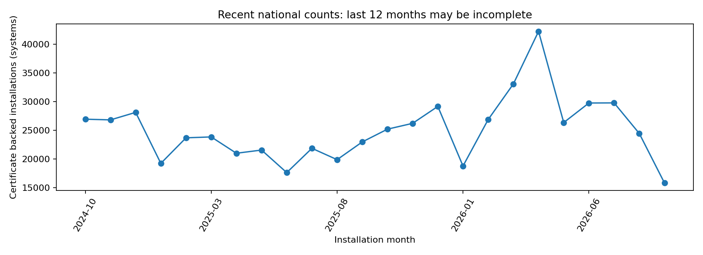

# Task 1 audit — Gate A review

**Verdict: CONDITIONAL GO.** The files support observed monthly postcode counts and a validated rook graph. Acceptance remains with the researcher. Coverage gaps, unmatched postcodes and the isolate policy need explicit review before Task 2. This is a data-feasibility assessment, not a scientific conclusion.

## Provenance and dates

Saved CER page current as at **30 September 2026**. The CSV header preambles contain no embedded current-as-at date; it is not inferred from retrieval or last-modified dates. The last month permitted by the task's data-date-minus-12-month rule is **2025-09**. This is a reporting-lag cutoff, not evidence of historical data vintages: no archived as-of snapshots were obtained.

All raw sizes and SHA256 checksums were independently verified by `python -m audit.finalize`.

| Raw file | Bytes | Retrieved (UTC) | SHA256 |
| --- | ---: | --- | --- |
| [data/raw/abs_ed3_non_abs.zip](https://www.abs.gov.au/statistics/standards/australian-statistical-geography-standard-asgs/edition-3-july-2021-june-2026/access-and-downloads/digital-boundary-files/ASGS_Ed3_Non_ABS_Structures_GDA2020_updated_2025.zip) | 704005275 | 2026-10-28T11:33:04.874252+00:00 | `1ae078ad3dde5790be06672d461d17f7cb27818c7b9713f4f35473ce0f2b3b8c` |
| [data/raw/cer_page.html](https://cer.gov.au/markets/reports-and-data/small-scale-installation-postcode-data) | 275888 | 2026-10-28T11:48:38.136597+00:00 | `889e8830c16a5ebabfb0c5c4a5661f552103281cc28f3f553025159554275ee7` |
| [data/raw/sgu_solar_recent.csv](https://cer.gov.au/document/sgu-solar-installations-2011-to-present-and-totals) | 1236641 | 2026-10-28T11:48:38.448598+00:00 | `18474fe10be68f5185a009ff7e7523553662c49d5dfcc65621fe15101aadf3f4` |
| [data/raw/sgu_solar_early.csv](https://cer.gov.au/document/sgu-solar-installations-2001-to-2010) | 685667 | 2026-10-28T11:48:38.712994+00:00 | `85046bebc4a8c19238f0e406a2fc20862e1a0922fc36814c189b5670b5e51dd2` |

ABS Edition 3 GDA2020 Non ABS Structures is used. [Edition 4 Postal Areas](https://www.abs.gov.au/statistics/standards/australian-statistical-geography-standard-asgs/edition-4-july-2026-june-2031/non-abs-structures/postal-areas) were released on 14 October 2026, as checked during preparation; no edition switch was made.

## CER layout and quality

Target: monthly certificate backed solar PV installations, including upgrades and off-grid systems. Units are systems, not adopters. Both files are wide. Monthly headers are month/year plus Installation(s) Quantity; the first field is Small Unit Installation Postcode. The recent file also has historical and overall totals. Full column lists are in `cer_profile.json`.

| File | Postcode rows | Months | First | Last | Duplicate postcode rows | Invalid monthly cells | Blank monthly cells |
| --- | ---: | ---: | --- | --- | ---: | ---: | ---: |
| data/raw/sgu_solar_early.csv | 2809 | 117 | 2001-04 | 2010-12 | 0 | 0 | 0 |
| data/raw/sgu_solar_recent.csv | 2811 | 189 | 2011-01 | 2026-09 | 0 | 0 | 0 |

Monthly keys are unique, postcodes remain four-character strings, counts are nonnegative integers and months are ordered. Explicit zeros are present; blanks are not converted to zeros. No internal month-column gaps were found. January–March 2001 are absent from the early file and have not been invented.

Annual national sums match every year in the saved CER Solar PV national table (26 years). See `annual_national_comparison.csv`; this comparison uses the snapshot at download, not a later live page.

Historical-total comparison: 2809 matching postcodes and 2 nonmatching comparisons. Details are in `historical_total_discrepancies.csv`. Nonmatching codes are 1825, 4513. Their reported historical totals are zero, but neither has an early-file row. Their missing monthly sums remain missing; no zero is imputed.

## Panel and postcode join

The observed panel has 859,932 postcode-month cells, 2,811 postcodes and 306 distinct months. The graph has 2,641 spatial Postal Areas; 2,634 have CER observations. Matched observations comprise 806,004 cells. 2,634 Postal Areas have every covered month; 2,142 cells are missing relative to the spatial-POA-by-covered-month rectangle. No missing count is imputed.

Zero share among observed matched Postal Area-month cells: **49.428539%**. Denominator excludes missing observations; see `poa_month_coverage.csv` for every node's months, zeros and missing observation count.

Matched CER postcodes: **2,634/2,811 (93.703308%)**. Matched installation share: **99.950945%**. Unmatched postcodes: **177**, all retained with installation totals in `postcode_poa_join.csv`. No location is assigned to unmatched codes. Any special CER codes are separately listed in `cer_special_codes.csv`.

Postal Areas are approximations of postcodes. This audit checks code equality, not exact postal-boundary correspondence. It does not establish stable geographic definitions over the full historical period.

## Border graph

Validated artifacts: **2,641 nodes, 7,051 undirected rook edges, 76 additional queen-only edges, 19 connected components and 16 isolates**. No self loops, duplicate edges or unknown endpoints. Saved degrees and components agree with the edge list. Every saved rook edge shares a positive-length boundary and every queen-only edge is point contact. All raw hashes and node geometry checks passed. This validates the existing artifacts without rebuilding the graph; completeness relies on the spatial-index candidate enumeration in `geography.graph`.

Component sizes, largest first: [2509, 112, 4, 1, 1, 1, 1, 1, 1, 1, 1, 1, 1, 1, 1, 1, 1, 1, 1].

| Degree | Postal Areas |
| ---: | ---: |
| 0 | 16 |
| 1 | 62 |
| 2 | 205 |
| 3 | 334 |
| 4 | 461 |
| 5 | 493 |
| 6 | 381 |
| 7 | 250 |
| 8 | 177 |
| 9 | 112 |
| 10 | 54 |
| 11 | 31 |
| 12 | 24 |
| 13 | 13 |
| 14 | 5 |
| 15 | 4 |
| 16 | 3 |
| 17 | 5 |
| 18 | 1 |
| 20 | 1 |
| 21 | 3 |
| 22 | 1 |
| 23 | 2 |
| 28 | 1 |
| 30 | 1 |
| 31 | 1 |

Isolated Postal Areas: 2898, 2899, 3921, 4025, 4183, 4184, 4507, 4819, 4875, 6161, 6712, 6798, 6799, 7255, 7256, 7257.

**Proposed rule, not applied:** retain isolated areas as nodes with no geographic neighbours. Do not invent mainland or nearest-neighbour edges for islands. Future modelling must define their own-history path and the representation of an empty neighbour set in Task 2; no such feature or model is implemented here. Retain all connected components. Researcher approval is required.

Approved special-row treatment is separate: ABS 9494, 9797 and ZZZZ have NULL geometry. Their attributes are in `abs_special_rows.csv`; only graph membership is excluded, with approval and reasons in `exclusions.csv`. No CER records have been excluded.

## Reporting lag



The figure contains 24 national monthly counts ending 2026-09. Values are in `reporting_lag.csv`. Counts in the recent tail can still rise under the certificate creation period. No correction or nowcast is applied.

## Gate A decisions

1. Accept the join rate and retained unmatched-code ledger, or request further investigation.
2. Approve the proposed isolate rule: retain nodes with no artificial geographic links.
3. Accept the observed panel coverage provisionally. Missing early months, postcodes absent from the early file, and graph nodes without CER records remain missing; no zero-filling policy is approved.
4. Accept CONDITIONAL GO for Task 1, or request revisions. Task 2 must resolve modelling eligibility and vintage leakage before a protocol is frozen. No forecasting work starts here.

## Reproduction

From a fresh clone, the researcher runs `scripts/setup.ps1` for the pinned environment. Download commands below are researcher commands when sizes are unknown or exceed the configured limit. Raw downloads use exclusive creation and must not be repeated over existing files. Approval for the three special graph rows is documented in STATUS.md and the exclusion ledger.

```powershell
& .\scripts\setup.ps1
# Remaining commands use the installed environment's Python:
& .venv\Scripts\python.exe -m download.fetch cer 2>&1 | Tee-Object logs/t01_download_cer.log
& .venv\Scripts\python.exe -m download.fetch abs 2>&1 | Tee-Object logs/t01_download_abs.log
& .venv\Scripts\python.exe -m audit.profile 2>&1 | Tee-Object logs/t01_profile.log
& .venv\Scripts\python.exe -m geography.graph 2>&1 | Tee-Object logs/t01_graph.log
& .venv\Scripts\python.exe -m audit.lag 2>&1 | Tee-Object logs/t01_lag.log
& .venv\Scripts\python.exe -m audit.finalize 2>&1 | Tee-Object logs/t01_finalize.log
& .venv\Scripts\python.exe -m pytest -q 2>&1 | Tee-Object logs/t01_tests_gate_a.log
```

All measurements in this report are generated or validated by `audit.finalize`; the profile and graph artifacts are produced by the commands above. `final_validation.json` holds machine-readable checks. A fresh download may contain revisions and will not necessarily reproduce the historical snapshot's values; exact reproduction requires the recorded raw hashes. The graph terminal log was lost through the incomplete Tee-Object filename, so the existing saved artifacts were checked independently rather than rerun.
